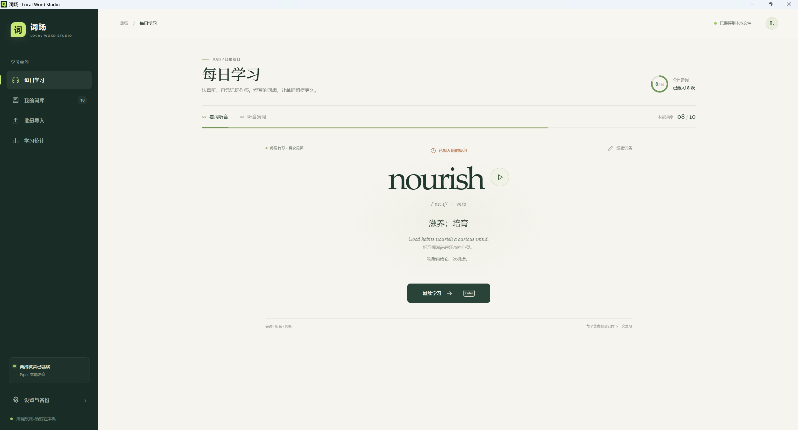

# 词场 · Local Word Studio

> 给每天的词汇练习，一张安静、清晰又耐看的桌面。

**词场**是一款本地优先的英语词汇学习应用。它把专注练习、间隔复习、离线发音和个人词库放进一套轻盈的桌面体验里：打开就能学，数据留在自己的设备上。

<p align="center">
  
</p>

<p align="center">
  <strong>安静专注的界面 · 越学越懂你的复习节奏 · 完整掌握自己的词库和数据</strong>
</p>

## 为专注学习设计

词场选择温和的暖白画布与沉静的深绿导航，用克制的线条、留白和衬线单词排版突出眼前的词。每日目标、练习进度、发音和释义各就其位；界面保持轻松，也让一次次短练习更容易开始。

## 功能一览

| | 功能 | 体验 |
| --- | --- | --- |
| **01 · 专注练习** | 看词听音、听音猜词 | 两种练习路径，搭配鼠标或快捷键；答完即可继续，不打断节奏。 |
| **02 · 计次复习** | 按答题表现和答题轮次安排复习 | 不会的词留在本轮稍后重练；答对的词逐步拉开题目间距。 |
| **03 · 灵活词库** | 搜索、筛选、编辑和播放词条 | 记录释义、词性、音标、多条例句与自己的录音；区分新词、待复习和已掌握。 |
| **04 · 批量导入** | 导入 CSV、TXT、JSON | 写入前先预览有效词、重复项、错误行与待补字段；可选跳过或更新已有词条。 |
| **05 · 离线发音** | Piper 神经语音，本机合成 | 使用内置美式英语语音，导入后在后台分批生成发音；无需云端 TTS。 |
| **06 · 学习统计** | 查看练习记录与近七天节奏 | 每日练习次数、记忆状态和连续学习情况一目了然。 |
| **07 · 本地掌控** | 自动保存、备份与恢复 | 词库、复习记录和录音保存在本机；完整 JSON 可备份迁移，也能单独导出 CSV。 |

首次打开时自带 **18 个手工整理的演示词条**，用于体验界面和学习流程。它们不是完整词典；自己的单词可以随时导入并练习。

## 快速开始

需要 Node.js 20.19+（或 22.12+）、npm 和 Git LFS。LFS 用于获取内置离线语音模型。安装好 Git LFS 后运行：

```bash
git lfs install
git clone https://github.com/zhangyuankun01/cichang-local-word-studio.git
cd cichang-local-word-studio
npm install
npm run build
npm start
```

Windows 用户也可以双击 [`启动词场.cmd`](启动词场.cmd)。开发模式和桌面发行包构建方法见下文。

> Windows 桌面版内置 Piper 运行时与 Lessac 美式英语语音。首次安装及构建可能需要网络下载依赖；安装完成后，学习、备份和发音均可离线使用。所有个人词库数据留在本机。

## 界面与页面

- **每日学习**：突出当前单词，提供发音、两种练习模式、记忆反馈和复习进度。
- **我的词库**：搜索并筛选新词、待复习和已掌握词条，可直接编辑或播放。
- **批量导入**：先检查文件内容和重复项，再确认写入。
- **学习统计**：查看练习次数、记忆状态与最近一周的学习节奏。
- **设置与备份**：管理离线语音、每日新词目标、数据位置及备份恢复。

## 运行环境

- Node.js 20.19+（或 22.12+）及 npm。建议使用受支持的长期维护版本。
- Electron 桌面运行环境随依赖安装。桌面发行包按操作系统和 CPU 架构生成。
- Windows 桌面发行包内置 Piper 离线语音引擎和英语模型；初次下载安装包需要网络，安装后合成语音无需联网。

## 安装与启动

```bash
git clone <your-repository-url>
cd <repository-folder>
npm install
```

打开独立桌面窗口，先构建本地界面，再启动 Electron：

```bash
npm run build
npm start
```

Windows 下也可在项目文件夹中双击 [`启动词场.cmd`](启动词场.cmd) 打开桌面应用。不要直接双击项目根目录的 `index.html`：它引用未编译的 TSX 源码，用浏览器直接打开会显示空白页。

也可在两个终端里进行热更新开发：

```bash
# 终端 1：只监听本机回环地址
npm run dev -- --host 127.0.0.1
```

```bash
# 终端 2：单独的 Electron 窗口
npx electron electron/main.cjs --dev
```

在浏览器中预览 React 界面可使用 `npm run dev -- --host 127.0.0.1`，然后打开 `http://127.0.0.1:5173/`；该方式便于开发，但不是独立桌面窗口。应用的运行时代码不会调用在线 API。开发模式的本地 Vite 服务只绑定本机回环地址。

## 构建桌面发行包

```bash
npm run build
npx electron-builder --config electron-builder.config.cjs
```

安装包会放在 `release/`。Windows NSIS、macOS DMG 和 Linux AppImage 应在各自目标操作系统上构建；跨平台构建受宿主系统及系统签名工具约束。首次执行会下载对应 Electron 运行时，因此构建发行包需要网络；已经生成的安装包运行、复习、导入和 Piper 合成均不需要网络。离线构建时应预先准备 npm 缓存与 Electron 二进制缓存。

## 导入词库

进入 **批量导入**，选择 CSV、TXT 或 JSON。应用会读取并检查文件，展示有效词条、重复项、错误行及待补内容；确认后才会写入本地词库。

### TXT

最简单的格式是每行一个英文单词。也可使用 Tab 分隔字段，顺序为单词、释义、词性、音标、英文例句、例句翻译。

```text
serendipity
resilient
subtle
```

100 词示例见 [`examples/100-words.txt`](examples/100-words.txt)。

### CSV

使用 UTF-8 编码。支持带引号、逗号和换行的字段；推荐列名 `word,meaning,part_of_speech,phonetic,example,translation`。界面也提供可下载的模板。`word`、`english`、`term`、`单词`、`英文` 等可作为单词列名；其他常见字段名也支持中英文别名。

仓库内也有一份可直接导入的 [`examples/sample-vocabulary.csv`](examples/sample-vocabulary.csv)。

```csv
word,meaning,part_of_speech,phonetic,example,translation
"serendipity","机缘巧合","noun","/ˌser.ənˈdɪp.ə.ti/","A little serendipity brought them together.","一次偶然的机缘让他们相遇。"
"resilient","有韧性的","adjective","/rɪˈzɪl.jənt/","She stayed resilient.","她保持着韧性。"
```

### JSON

支持词条数组、字符串数组，或 `{ "words": [...] }`。释义等字段可省略；缺失字段不会阻止有效单词导入。可选的 `audioData` 接受 `data:audio/...;base64,...` 格式。

```json
[
  {
    "word": "vivid",
    "meaning": "生动的；鲜明的",
    "partOfSpeech": "adjective",
    "phonetic": "/ˈvɪv.ɪd/",
    "example": "I remember the day.",
    "translation": "我记得那一天。"
  }
]
```

CSV/TXT/JSON 单词文件中的释义缺失时，应用只会尝试匹配随项目附带的 18 个演示词条，不会访问在线词典，也不会推测不可靠的解释。其他词条可先导入，之后从词库补齐。一个字段内以换行分隔多个例句和对应翻译；多个释义可用分号分开。

文件内部重复行在预览时标记并保留首条。和现有词库重复时，可选择 **跳过，不覆盖**（默认）或 **更新已有词条**；更新仅覆盖文件中非空字段，保留原有学习进度。空行会忽略，无效英文词、缺少单词列及 CSV 未闭合引号都会显示问题，不会悄悄覆盖已有数据。

## 离线发音

词场不请求云端语音服务，也不把单词发送给网络 TTS。顺序如下：

1. 如果词条有可播放的本地录音，先播放录音。
2. 缺少录音时，桌面版使用内置 Lessac 高品质美式英语神经模型合成 WAV。
3. 否则，仅尝试浏览器报告为 `localService` 的英语语音；不会主动选用被报告为远程服务的语音。
4. 引擎不可用或播放失败会给出明确提示，并提供打开语音设置的入口；不会静默略过。

导入完成后，桌面应用会自动扫描还没有录音的单词，按每批最多 24 个逐批生成语音并保存。可以继续学习；应用关闭时尚未完成的词会在下次启动后继续排队。单词文本只在本机处理，不会发送到云端语音服务。设置页显示语音引擎状态，也允许有需要的用户改用自己的 Piper 文件。

### 发音范围与质量

- 默认模型是 Lessac 美式英语 high 质量，22.05 kHz。常见词通常能正常发音；专有名词、复合词、异常拼写和有多种读音的同形词仍取决于拼写转音素结果。
- 用户可附加小于 1 MB 的 WAV、MP3、M4A 等本地录音。录音有损坏或无法解码时，会转用本地语音，并显示提示。
- 模型按批次处理大量导入词条。音频与词库一同存放在本机，桌面版数据上限为 512 MB；词条特别多时建议定期导出备份。

## 本地数据、备份与迁移

桌面版使用应用数据目录下的 `study-data.json` 原子写入词库、复习间隔、每日学习统计、当前队列与生成的音频。内置 Piper 程序和模型随安装包提供；如果用户在设置中选择自定义路径，路径保存在 `piper-config.json`。建议在 **设置与备份** 中导出完整 JSON 备份，并把备份存到外置磁盘或版本化备份目录。CSV 只包含词条资料，不包含复习进度。

默认数据目录：

- Windows：`%APPDATA%/Cichang Local Word Studio`
- macOS：`~/Library/Application Support/Cichang Local Word Studio`
- Linux：`~/.config/Cichang Local Word Studio`

设置页面可直接打开该目录。浏览器预览版改用当前浏览器的 `localStorage`，不同浏览器、用户配置和源地址之间不会自动共享数据。浏览器存储容量有限，桌面版更适合长期使用和保存录音。

跨机器迁移建议：在旧设备导出完整 JSON，安装相同或更新的词场桌面版，在新设备的 **设置与备份** 恢复该 JSON。Windows 安装包自带语音模型；自定义 Piper 路径需在新设备重新选择。也可以退出应用后手动备份整个数据目录；不要只复制正在写入的文件。

## 复习规则

- 新词按创建时间排队，每天初次学习上限默认 10 个，可在设置调整；待复习词优先加入队列。
- 复习按答题次数推进，不按分钟或日期安排。“认识”后词条会在几道其他题后再次出现，连续答对 3 次后进入巩固轮换；已掌握词会按全局答题次数逐渐拉开复习间隔。当没有词条达到轮次时，会挑选最早应复习的词继续练习，不会让队列因为等待计数而停住。
- “还不认识”会清零连续答对次数，并把词条放回当前练习队列稍后重试；答错的词不会被跳过。
- 设置中可分别输入每天的新词上限（默认 10）和复习词上限（默认 30，均可设为 0–500）；当前轮次的错词重试不重复占用计划名额。
- 完成一轮后重新打开应用，会自动生成下一轮队列；若当天计划额度已用完，可在设置中提高数量后刷新队列。
- 旧版备份可直接继续使用；旧版已掌握词保留掌握状态，其他词从待巩固阶段继续。
- 答题时立即写入进度；当前练习队列和答案反馈也会保存，同一天重新打开可继续。
- 快捷键：空格重播；`1` 还不认识；`2` 认识；反馈页按 Enter 继续。输入框聚焦时快捷键不触发。

## 开发

- `src/App.tsx`：主界面、导入审核与学习流程。
- `src/domain.ts`：数据结构、内置演示词与复习队列规则。
- `src/importer.ts`：CSV、TXT、JSON 解析与格式校验。
- `electron/main.cjs`、`electron/preload.cjs`：独立窗口、本地文件存储、Piper 子进程和安全 IPC 桥接。
- `electron-builder.config.cjs`：桌面发行包配置。

React 和 Tailwind CSS 只用于本地渲染；主进程限制页面导航，关闭 Node 集成并启用 context isolation 和 sandbox。新增桌面能力请通过最小化的 preload IPC 暴露，不要在 renderer 中直接开启 Node 集成。

## 词库、音频与许可

- 本项目包含的 18 个演示词条与示例句由项目整理，不是从外部词典或音频数据集中批量复制；应用与内置示例采用仓库 MIT 许可证。
- Windows 安装包包含 Piper Windows runtime、eSpeak NG、ONNX Runtime 与 Lessac high 声音模型；各组件的许可证和来源详见 [THIRD-PARTY-LICENSES.md](THIRD-PARTY-LICENSES.md)。
- 用户导入的词库与音频由用户自行负责许可和使用权限；数据文件只留在用户选择的本地设备与备份位置。

## 已知限制与后续方向

- 不含大规模离线英汉词典或自动例句服务；目前只对 18 个演示词提供离线词条补全。
- 每条词目当前使用文本字段保存释义和例句；通过换行支持多个例句及逐行翻译，释义可用分号保存多项。
- 桌面版基于 Electron，跨机器通常需要对应平台安装包；备份 JSON 是推荐的迁移格式。
- 后续可选方向：可审核许可的离线词典包、模型预览与诊断、更多复习算法、桌面签名发布以及导入回归测试集。

## 许可

本项目以 [MIT License](LICENSE) 发布。第三方运行时依赖及由用户安装的语音引擎/模型遵循各自的许可证。
